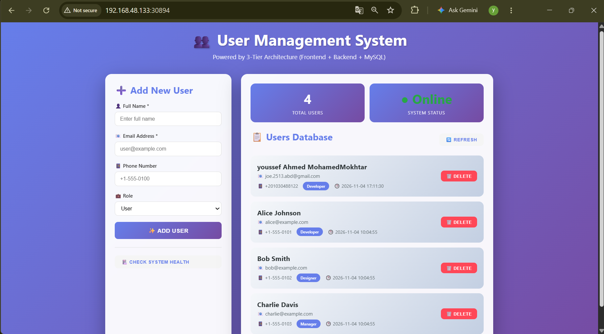
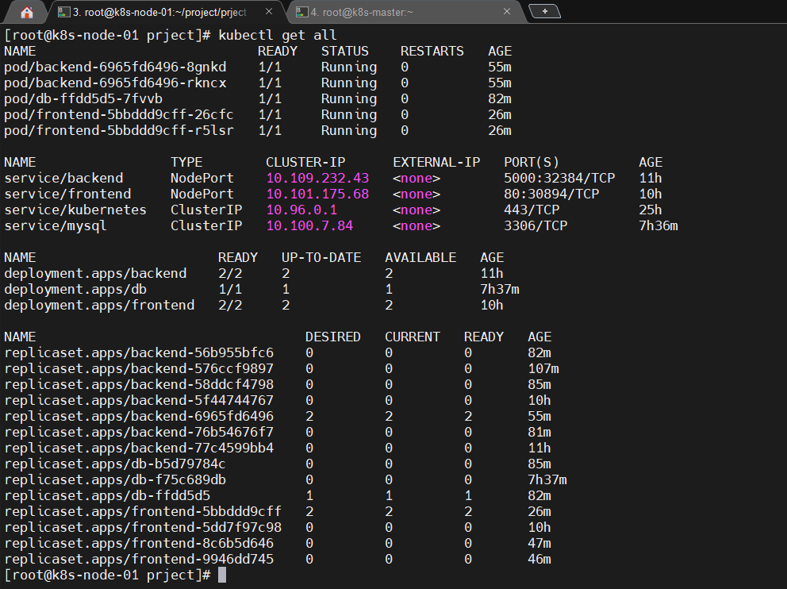
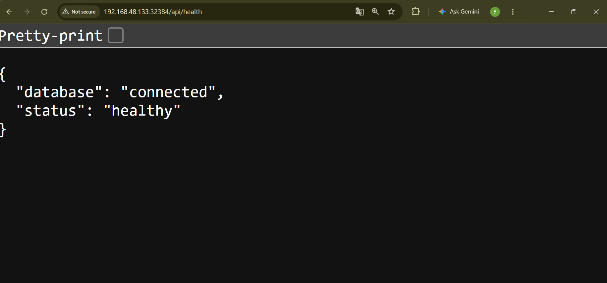

# 3-Tier User Management App on Kubernetes

A small user management app (add, list, delete users) split into three containerized tiers and deployed on a **2-node kubeadm Kubernetes cluster** with **Calico** networking.




## Contents

- [Architecture](#architecture)
- [Screenshots](#screenshots)
- [Tech stack](#tech-stack)
- [What this project covers](#what-this-project-covers)
- [Project structure](#project-structure)
- [Prerequisites](#prerequisites)
- [1. Build the images](#1-build-the-images)
- [2. Configuration and secrets](#2-configuration-and-secrets)
- [3. Deploy](#3-deploy)
- [4. Access and test](#4-access-and-test)
- [API endpoints](#api-endpoints)
- [Troubleshooting](#troubleshooting)
- [Cleanup](#cleanup)
- [Known limitations and next steps](#known-limitations-and-next-steps)
- [Author](#author)

## Architecture

```
                 ┌────────────────────────── Kubernetes cluster ──────────────────────────┐
                 │                                                                          │
 Browser ──────► │  frontend Service ──► Nginx pods ──/api──► backend Service ──► Flask pods │
                 │                       (2 replicas)                            (2 replicas)│
                 │                                                                   │      │
                 │                                          mysql Service ◄──────────┘      │
                 │                                                │                         │
                 │                                          MySQL pod ──► PVC ──► PV        │
                 └──────────────────────────────────────────────────────────────────────────┘
```

The browser only ever talks to the frontend. Nginx serves the static page and proxies every `/api/*` request to the backend Service. In the manifests the backend Service is `ClusterIP`, so it is only reachable inside the cluster, and the database is only reachable from the backend through cluster DNS.

## Screenshots

The app UI is shown at the top. Below is the cluster state and the backend health check.

**All pods, services and deployments running** (2 backend, 2 frontend, 1 database):



**Backend health check** returning `connected` from the database (here the backend Service was temporarily switched to NodePort to call it directly):



## Tech stack

| Tier     | Technology                                         | Image                                  |
| -------- | -------------------------------------------------- | -------------------------------------- |
| Frontend | HTML/JS served by Nginx (reverse proxy for `/api`) | `youssefabdelsalllam1/my-frontend-app` |
| Backend  | Python 3.10, Flask, Flask-CORS, mysql-connector    | `my-backend-app`                       |
| Database | MySQL 8.0 with persistent storage                  | `mysql:8.0`                            |

## What this project covers

- Writing a Dockerfile for each tier and building the images
- Deployments with multiple replicas, and Services for stable networking between tiers
- Service discovery through cluster DNS (`backend`, `mysql`)
- Configuration with ConfigMaps, and credentials with Secrets kept out of Git
- Persistent storage with a PersistentVolume and PersistentVolumeClaim
- Initializing a database from a ConfigMap mounted into `/docker-entrypoint-initdb.d/`
- Debugging a real cluster: Calico, CoreDNS and firewall problems (see [Troubleshooting](#troubleshooting))

## Project structure

```
.
├── backend/
│   ├── app.py                      # Flask REST API
│   ├── requirements.txt
│   └── Dockerfile
├── database/
│   └── init.sql                    # Creates the users table and seed data
├── frontend/
│   ├── index.html                  # UI
│   ├── nginx.conf                  # Serves the UI and proxies /api to the backend
│   └── Dockerfile
└── K8s/
    ├── app-config.yaml             # ConfigMap (DB host, port, name)
    ├── mysql-secret.example.yaml   # Secret template (the real one is git-ignored)
    ├── my-pv.yaml                  # PersistentVolume
    ├── my-pvc.yaml                 # PersistentVolumeClaim
    ├── database-deployment.yaml
    ├── database-svc.yaml
    ├── backend-deployment.yaml
    ├── backend-svc.yaml
    ├── frontend-deployment.yaml
    └── frontend-svc.yaml
```

## Prerequisites

- A running Kubernetes cluster (this was built on 2 nodes with kubeadm and Calico)
- `kubectl` configured to talk to it
- Docker on the machine where you build the images
- A Docker Hub account if you want to push the images

## 1. Build the images

```bash
# Frontend (pushed to Docker Hub so every node can pull it)
docker build -t youssefabdelsalllam1/my-frontend-app:latest ./frontend
docker push youssefabdelsalllam1/my-frontend-app:latest

# Backend (built locally; the Deployment uses imagePullPolicy: Never)
docker build -t my-backend-app:latest ./backend
```

With `imagePullPolicy: Never`, the backend image must exist on **every node that can run the pod**. Either push it to a registry and remove `imagePullPolicy: Never` from the Deployment, or export and import it on each node:

```bash
docker save my-backend-app:latest -o backend.tar
ctr -n k8s.io images import backend.tar     # run on each node
```

### How the Dockerfiles work

**Frontend** serves the page with Nginx and forwards `/api/*` to the backend Service:

```dockerfile
FROM nginx:alpine
COPY index.html /usr/share/nginx/html/index.html
COPY nginx.conf /etc/nginx/conf.d/default.conf
EXPOSE 80
```

```nginx
location /api/ {
    proxy_pass http://backend:5000;   # the backend Service name, resolved by cluster DNS
}
```

> Use the Service **name** here, not its ClusterIP. A ClusterIP changes if the Service is ever recreated, and the name does not.

**Backend** runs the Flask API on port 5000:

```dockerfile
FROM python:3.10-slim
WORKDIR /app
COPY requirements.txt .
RUN pip install --no-cache-dir -r requirements.txt
COPY . .
EXPOSE 5000
CMD ["python", "app.py"]
```

**Database** uses the official `mysql:8.0` image. The schema comes from `database/init.sql` through a ConfigMap.

## 2. Configuration and secrets

### ConfigMap: application settings

`K8s/app-config.yaml` holds non-sensitive settings, injected into the backend (and the database name into MySQL) as environment variables:

```yaml
apiVersion: v1
kind: ConfigMap
metadata:
  name: app-config
data:
  DB_HOST: mysql
  DB_PORT: "3306"
  DB_NAME: mydb
```

### ConfigMap: database init script

The MySQL image runs any `.sql` file in `/docker-entrypoint-initdb.d/` on first start. The script is stored as a ConfigMap and mounted there:

```bash
kubectl create configmap mysql-init --from-file=database/init.sql
```

### Secret: database credentials

Credentials live in a Kubernetes Secret and are injected as `DB_USER` and `DB_PASSWORD` (backend) and `MYSQL_ROOT_PASSWORD` (database). The real `mysql-secret.yaml` is **not committed** (see `.gitignore`). Create your own from the template:

```bash
cp K8s/mysql-secret.example.yaml K8s/mysql-secret.yaml
echo -n 'root' | base64             # use as username
echo -n 'YourStrongPass' | base64   # use as password
```

Or create it directly without a file:

```bash
kubectl create secret generic mysql-secret \
  --from-literal=username=root \
  --from-literal=password='YourStrongPass'
```

> Base64 is encoding, not encryption. For real environments use Sealed Secrets or an external secret manager.

## 3. Deploy

Run from the repository root, in this order:

```bash
# 1. Configuration
kubectl apply -f K8s/app-config.yaml
kubectl apply -f K8s/mysql-secret.yaml
kubectl create configmap mysql-init --from-file=database/init.sql

# 2. Storage
kubectl apply -f K8s/my-pv.yaml
kubectl apply -f K8s/my-pvc.yaml

# 3. Database, then backend, then frontend
kubectl apply -f K8s/database-deployment.yaml -f K8s/database-svc.yaml
kubectl apply -f K8s/backend-deployment.yaml  -f K8s/backend-svc.yaml
kubectl apply -f K8s/frontend-deployment.yaml -f K8s/frontend-svc.yaml
```

> Apply files one by one as shown. Do not run `kubectl apply -f K8s/` on the whole folder: it would also try to apply the `.example` secret, which contains placeholder values.

Check that everything is running:

```bash
kubectl get pods,svc,pvc
```

| Component | Deployment | Replicas                | Service    | Type      | Port |
| --------- | ---------- | ----------------------- | ---------- | --------- | ---- |
| Frontend  | `frontend` | 2                       | `frontend` | NodePort  | 80   |
| Backend   | `backend`  | 2                       | `backend`  | ClusterIP | 5000 |
| Database  | `db`       | 1 (`Recreate` strategy) | `mysql`    | ClusterIP | 3306 |

The database uses the `Recreate` strategy because two MySQL pods must never write to the same data directory at once.

## 4. Access and test

The frontend Service is of type `NodePort`, so it is reachable on any node's IP. Find the port:

```bash
kubectl get svc frontend
# 80:3XXXX/TCP  -> the port after the colon is the NodePort
```

Open `http://<node-ip>:<nodeport>` in your browser, then test the API through the frontend:

```bash
curl http://<node-ip>:<nodeport>/api/health
# {"database":"connected","status":"healthy"}

curl http://<node-ip>:<nodeport>/api/users
```

**Check persistence:** delete the database pod and refresh the page. The users should still be there.

```bash
kubectl delete pod -l app=db
```

## API endpoints

| Method | Path              | Description                                   |
| ------ | ----------------- | --------------------------------------------- |
| GET    | `/api`            | Hello message                                 |
| GET    | `/api/health`     | Health check, including database connectivity |
| GET    | `/api/users`      | List users                                    |
| POST   | `/api/users`      | Add a user (`name` and `email` required)      |
| DELETE | `/api/users/<id>` | Delete a user                                 |

Example:

```bash
curl -X POST http://<node-ip>:<nodeport>/api/users \
  -H "Content-Type: application/json" \
  -d '{"name": "Sara Ali", "email": "sara@example.com", "role": "Developer"}'
```

Status codes: `201` created, `400` missing name or email, `404` user not found, `409` email already exists.

## Troubleshooting

Problems I hit while building this, and how I fixed them:

| Symptom                                                             | Cause                                                                                                   | Fix                                                                                                                 |
| ------------------------------------------------------------------- | ------------------------------------------------------------------------------------------------------- | ------------------------------------------------------------------------------------------------------------------- |
| UI shows "Network error: Failed to fetch"                           | `index.html` called `http://localhost:5000`, which in a browser means the user's own machine            | Use a relative `/api` URL and proxy it through Nginx to the backend Service                                         |
| Backend: `Unknown MySQL server host 'mysql'`                        | Pods could not reach cluster DNS because `calico-node` was not Ready and firewalld was blocking traffic | Stopped/disabled firewalld on both nodes and restarted Calico; used the Service ClusterIP as a workaround meanwhile |
| Frontend `CrashLoopBackOff`: `host not found in upstream "backend"` | Nginx resolves the upstream name at startup, and DNS was down                                           | Fixed cluster DNS (above)                                                                                           |
| MySQL ignores new password or init script                           | `hostPath` volume already contained an initialized data directory                                       | Init variables and scripts only run on an empty data directory; wipe `/mnt/data` for a fresh start                  |

Useful commands:

```bash
kubectl logs -l app=backend --tail=30
kubectl describe pod -l app=db
kubectl get endpoints
kubectl get pods -n kube-system        # Calico and CoreDNS health
```

## Cleanup

```bash
kubectl delete -f K8s/frontend-deployment.yaml -f K8s/frontend-svc.yaml
kubectl delete -f K8s/backend-deployment.yaml  -f K8s/backend-svc.yaml
kubectl delete -f K8s/database-deployment.yaml -f K8s/database-svc.yaml
kubectl delete -f K8s/my-pvc.yaml -f K8s/my-pv.yaml
kubectl delete -f K8s/app-config.yaml
kubectl delete secret mysql-secret
kubectl delete configmap mysql-init
```

Deleting the PV does not wipe the data. It stays in `/mnt/data` on the node, so remove it there too for a completely fresh start.

## Known limitations and next steps

This is a learning project and a lab setup. These are the gaps I know about and plan to close:

- [ ] Add readiness and liveness probes using the existing `/api/health` endpoint
- [ ] Run the backend with Gunicorn instead of Flask's debug server
- [ ] Use a dedicated database user instead of `root`
- [ ] Replace the `hostPath` volume with a proper StorageClass (`hostPath` is tied to one node)
- [ ] Push both images to a registry and use versioned tags instead of `latest`
- [ ] Add resource requests and limits
- [ ] Use connection pooling and close connections reliably in `app.py`
- [ ] Add an Ingress in front of the frontend
- [ ] Jenkins CI/CD pipeline that builds the images, pushes them to Docker Hub, and deploys to the cluster

## Author

**Youssef Ahmed Abdelsalam**: [GitHub](https://github.com/youssefabdelsalam11)
